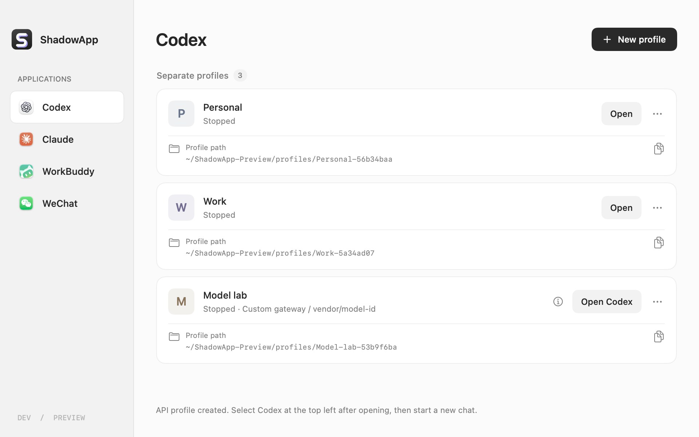
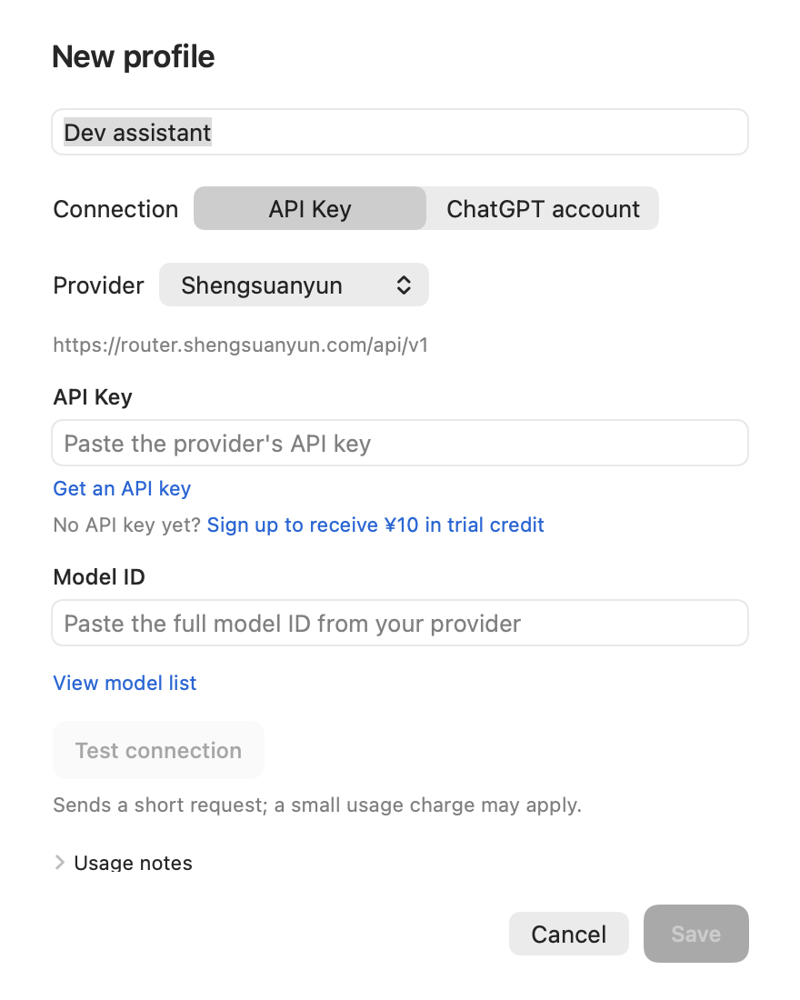
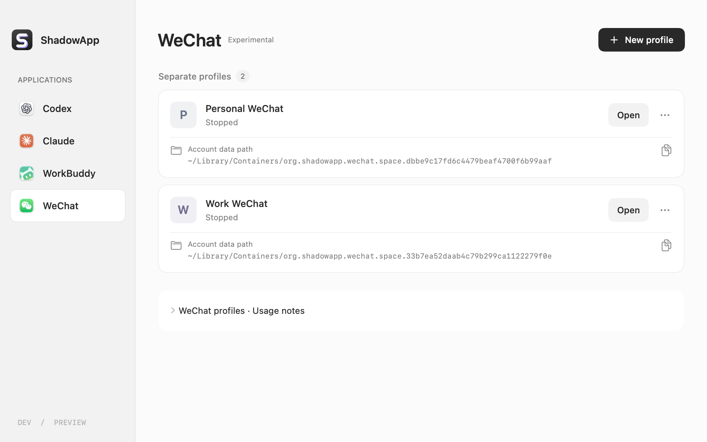

<p align="center">
  
</p>
<h1 align="center">ShadowApp</h1>
<p align="center"><strong>One launcher. Multiple apps. Separate account spaces.</strong></p>
<p align="center">Manage Codex, Claude, WorkBuddy and WeChat instances on your Mac.</p>
<p align="center">
  
  
  
  <a href="LICENSE"></a>
</p>
<p align="center">
  <a href="README.md">简体中文</a> · English · <a href="#get-started">Get started</a> · <a href="docs/COMPATIBILITY.md">Compatibility</a> · <a href="CHANGELOG.md">Changelog</a>
</p>



<p align="center"><sub>Rendered from the current SwiftUI views with example profiles. No real accounts or keys. ShadowApp-Preview is a temporary demonstration directory.</sub></p>

Keep personal accounts, work accounts and model configurations in separate profiles, then open the one you need. ShadowApp uses apps already installed on your Mac, without running a virtual machine or switching macOS users.

- **Organize by app.** Choose an app in the sidebar, then create and name its profiles.
- **Choose an account or an API key.** Codex and Claude support provider URLs, keys and model IDs.
- **Find the right window.** Open an instance, bring an existing window forward or quit a specific profile. Apps keep running when the launcher closes.
- **See where data lives.** Each profile shows its actual data path, with copy and Finder actions.

> ShadowApp was previously **Codex Multi**. The repository URL and existing storage paths are retained. This README describes the development version on `main`; the [v0.1.0 download](https://github.com/maimaimangmang/codex-multi/releases/tag/v0.1.0) is the older Codex Multi build and does not contain all the features shown here.

## Supported apps

| App | Connection | Current compatibility |
| --- | --- | --- |
| **Codex** | ChatGPT account / API key | Verified on `26.1016.51333`; required capabilities checked at launch |
| **Claude** | Claude account / API key | Preview for the verified `4.29.0` build |
| **WorkBuddy** | WorkBuddy account; models configured in the app | Multi-instance preview for the verified `5.8.3` build |
| **WeChat** | QR sign-in and phone confirmation | Experimental; Apple Silicon + Mac App Store `4.1.15 (270115)` only |

Data separation and feature coverage vary by app. Updates may require adapter changes. See the [compatibility record](docs/COMPATIBILITY.md), [WorkBuddy notes](docs/WORKBUDDY.md) and [WeChat notes](docs/WECHAT.md) for validation scope (technical records are in Chinese).

## Get started

### 1. Get the current version

Build the latest source with **macOS 13+, Swift 5.9+, and Xcode or Command Line Tools**. Install each target app separately and meet its own system requirements.

```bash
# Only if Apple developer tools are not installed
xcode-select --install

# Build for the architecture of this Mac
git clone https://github.com/maimaimangmang/codex-multi.git
cd codex-multi
bash scripts/build.sh
open "dist/$(uname -m)/ShadowApp.app"
```

You can move the resulting app to Applications. Builds use an ad-hoc local signature by default and are not Apple-notarized. See [distribution instructions](docs/PUBLISHING.md).

Alternatively, download the `shadowapp-preview` artifact from a successful [GitHub Actions build](https://github.com/maimaimangmang/codex-multi/actions/workflows/build.yml). This requires a signed-in GitHub account with repository access.

### 2. Create a profile

1. Select an app and choose **New profile**. Give it a recognizable name, such as “Work”.
2. Codex and Claude default to **API Key**. Switch to the account option when you want to sign in with that app's account.
3. Save and choose **Open**. For account profiles, sign in inside the new window. Complete sign-ins one at a time and check which account the browser selects.
4. Return through ShadowApp or its menu bar. Running instances offer **Show window**.

A profile name is your label, not an authenticated account identity. “Running” only means the process exists; it does not confirm sign-in or a working model connection. Existing windows can be brought forward without importing their credentials or history.

## API keys and custom models

<p align="center">
  
</p>

Choose **Shengsuanyun** for a preset endpoint or **Custom provider** for your own gateway. Paste a key and the full model ID supplied by your provider, then save the connection as a separate profile.

| Setting | Codex | Claude |
| --- | --- | --- |
| Required protocol | OpenAI **Responses API** | **Anthropic Messages API** |
| Shengsuanyun base URL | `https://router.shengsuanyun.com/api/v1` | `https://router.shengsuanyun.com/api` |
| Model ID | Full model ID supported by the provider | Claude model or its gateway routing ID |
| Where to start | Select **Codex** and create a new chat | Use the configured third-party inference provider |

[Get a Shengsuanyun API key](https://console.shengsuanyun.com/user/keys) · [Browse model IDs](https://global.modelmesh.info/model)

- **Try the connection.** Once the fields are complete, choose “Test connection”. This sends a short request and may incur a small charge. Saving alone does not run a test.
- **Match the protocol.** A Chat Completions-only endpoint is not sufficient for Codex. Streaming and tool use must also be compatible; a basic connection test does not establish full feature support. Renaming a DeepSeek or GLM model to Claude will not make it compatible with Claude Desktop.
- **Edit later.** Quit the profile, then choose “… → Model & API key”. Leave the key blank to retain it; changing the endpoint requires entering the corresponding key again.
- **Check model evidence.** Codex's “Model information” separates configured values from recent local session records. A model's self-description does not prove its actual route; consult provider records as well.

Keys are saved in local profile configuration, with sensitive files restricted to the current user, and are not written to the profile registry. Profile backups contain credentials and should be handled as account data. WorkBuddy models are configured in **Settings → Models** inside WorkBuddy, which still requires a WorkBuddy account.

## WeChat · Experimental



Select **WeChat → New profile → Open**. The first launch prepares a locally signed copy and shows WeChat's QR sign-in screen. Reopening may still require phone confirmation. SMS and API-key sign-in are not provided.

Each profile has its own app identity and macOS data container. The original installation is preserved. Copies retain App Sandbox and Hardened Runtime, but relax library signature validation, so their protections differ from the original. System sharing, File Provider extensions and external WeChat URL handlers are excluded from copies.

**Archiving preserves the app copy, sign-in information and chat data, and can be reversed.** Permanent deletion and importing earlier research copies are not currently available.

Independent launch, window identification, targeted quit, archive/restore and a single research profile's QR sign-in/reopen confirmation have been verified. **Two running instances do not prove that two accounts can remain online simultaneously.** Switching accounts on a phone may sign out the desktop. Full messaging, attachments, notifications and audio/video coverage remain pending. See the [implementation and validation record](docs/WECHAT.md).

## Where profiles are stored

Every profile card shows its path. The default root remains `~/CodexMulti` so existing data does not need to move after the rename. New folders use a name plus a short ID; renaming a profile does not relocate its data.

```text
~/CodexMulti/
├── profiles/                         Codex profiles
│   └── Work-a1b2c3d4/
│       ├── codex/                    Configuration, credentials, sessions
│       └── desktop/                  Desktop state
└── apps/
    ├── claude/profiles/               Claude profiles
    ├── workbuddy/profiles/            WorkBuddy profiles, including private HOME
    └── wechat/profiles/               WeChat copies and management records

~/Library/Containers/
└── org.shadowapp.wechat.space.<ID>/   Actual WeChat account data
```

If you use a legacy or custom location, follow the path shown in the app. Do not move a profile while it is running.

| Action | Effect |
| --- | --- |
| Quit ShadowApp | Opened apps continue running |
| Quit this instance | Requests a normal exit of that profile's app |
| Move to Trash (Codex / Claude / WorkBuddy) | Moves the whole profile folder, including local settings, credentials and history |
| Archive profile (WeChat) | Hides the profile and retains its app copy and system container for restoration |

## FAQ

**Why does an API profile ask for ChatGPT Work authentication?**

`Work browser access requires an authenticated account` concerns Work browser features. Switch to **Codex** in the top-left product menu and create a new chat. A provider key does not authenticate a ChatGPT Work account.

**Are profiles fully isolated?**

ShadowApp separates supported app data and configuration. Browser sign-in, system permissions and some link callbacks can still be shared. Profiles are not separate macOS users and do not bypass regional restrictions or account enforcement.

**What if an app stops opening after an update?**

Unrecognized Claude, WorkBuddy and WeChat builds are blocked while existing data is preserved. Read the compatibility notice. When reporting an issue, include macOS/app versions and the error text, without keys, authentication files or chat data.

**How do I switch languages?**

The interface follows the system's app language. In macOS, use **System Settings → General → Language & Region → Applications** to choose Chinese or English for ShadowApp.

## Development

Native SwiftUI and system frameworks, with no third-party Swift package dependencies.

```bash
bash scripts/test.sh                 # Core and state checks
bash scripts/build.sh arm64          # Apple Silicon
bash scripts/build.sh x86_64         # Intel build; target-app support varies
bash scripts/render-docs.sh          # Render bilingual images using temporary examples
```

Runtime checks launch target apps and should be run explicitly following their documentation. Normal tests and CI do not sign in to WeChat. Include the app, version, reproduction steps and expected behavior with issues and pull requests.

- [Architecture](docs/ARCHITECTURE.md) · [UI design](docs/UI_DESIGN.md)
- [Compatibility record](docs/COMPATIBILITY.md) · [Distribution](docs/PUBLISHING.md)
- [Image generation](docs/images/README.md) · [Changelog](CHANGELOG.md) · [Report an issue](https://github.com/maimaimangmang/codex-multi/issues)

Licensed under the [MIT License](LICENSE). ShadowApp is an independent community project, with no affiliation or authorized partnership with OpenAI, Anthropic or Tencent. App names, icons and trademarks belong to their respective owners.
