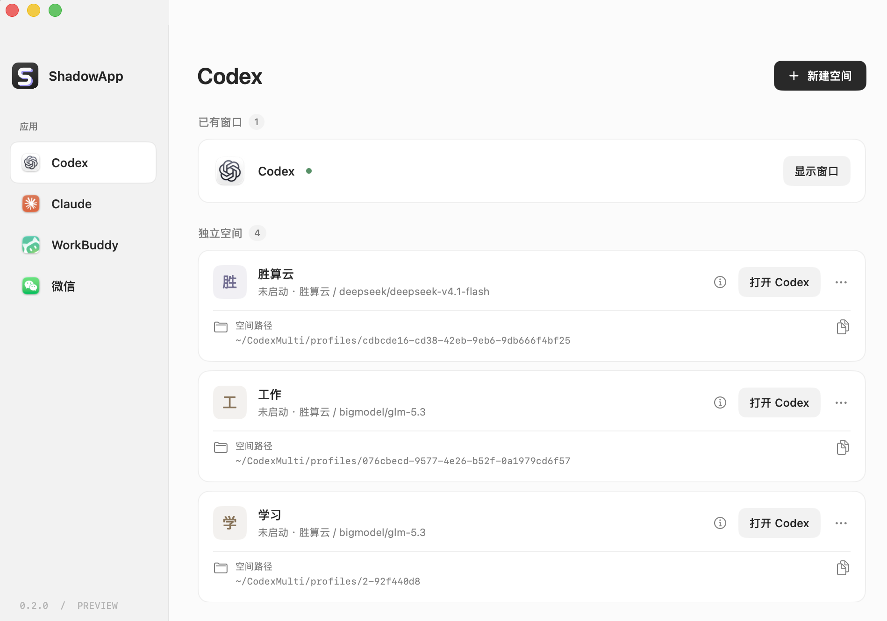
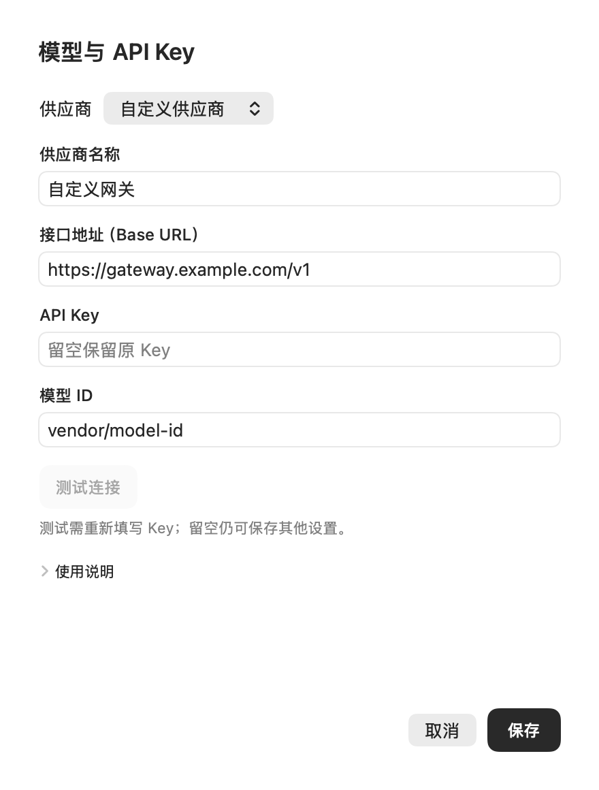
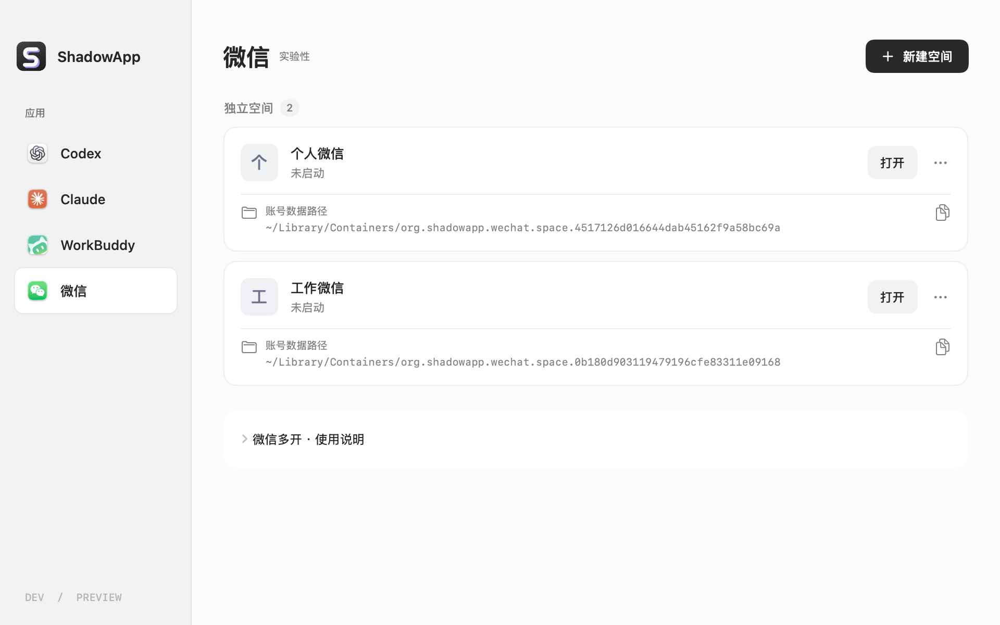

<p align="center">
  
</p>
<h1 align="center">ShadowApp</h1>
<p align="center"><strong>一个入口，多个应用，各自的账号空间。</strong></p>
<p align="center">Mac 上的 Codex、Claude、WorkBuddy 和微信多开管理器。</p>
<p align="center">
  
  
  
  <a href="LICENSE"></a>
</p>
<p align="center">
  简体中文 · <a href="README.en.md">English</a> · <a href="#快速开始">快速开始</a> · <a href="docs/COMPATIBILITY.md">兼容性记录</a> · <a href="CHANGELOG.md">更新日志</a>
</p>

<p align="center">
  <strong><a href="https://github.com/maimaimangmang/shadowapp/releases/download/v0.2.0/ShadowApp-0.2.0-arm64.dmg">下载 Mac 安装包 · M 系列芯片</a></strong><br>
  <a href="https://github.com/maimaimangmang/shadowapp/releases/tag/v0.2.0">v0.2.0 预览版 · 版本说明与校验文件</a>
</p>



把个人账号、工作账号和不同模型配置分开管理，需要哪个就打开哪个。可选择账号登录或使用其他供应商 API Key直接登录。ShadowApp 使用本机已安装的应用，无需额外运行虚拟机或切换 macOS 用户。

- **按应用管理**：在侧栏切换应用，创建和命名各自的空间。
- **账号与模型分开配置**：Codex、Claude 支持账号模式或供应商 API Key，可填写接口地址和模型 ID。
- **窗口随时找得到**：打开新实例、显示已有窗口、单独退出；退出 ShadowApp 后，应用仍可继续运行。
- **数据位置看得见**：每张空间卡片展示实际路径，可复制或在访达中打开。

> **v0.2.0 预览版。** ShadowApp 原名 Codex Multi，已有空间的数据会保留，无需迁移。旧版 v0.1.0 仍保留供查阅。

## 支持哪些应用

| 应用 | 连接方式 | 当前适配范围 |
| --- | --- | --- |
| **Codex** | ChatGPT 账号 / API Key | 已在 `26.1016.51333` 上验证；启动时检查所需能力 |
| **Claude** | Claude 账号 / API Key | 预览支持 `4.29.0` 的已验证构建 |
| **WorkBuddy** | WorkBuddy 账号；模型在应用内配置 | 多开预览，适配 `5.8.3` 的已验证构建 |
| **微信** | 微信扫码登录、手机确认 | 实验性；仅 Apple Silicon + Mac App Store `4.1.15 (270115)` |

不同应用的数据分离方式和功能范围不同。应用升级可能需要重新适配；完整验证范围见 [兼容性记录](docs/COMPATIBILITY.md)、[WorkBuddy 说明](docs/WORKBUDDY.md) 和 [微信说明](docs/WECHAT.md)。

## 快速开始

### 1. 下载安装

| 下载项 | 适用情况 |
| --- | --- |
| [下载 DMG 安装包](https://github.com/maimaimangmang/shadowapp/releases/download/v0.2.0/ShadowApp-0.2.0-arm64.dmg) | 推荐；M 系列芯片 Mac，macOS 13+ |
| [下载 ZIP 压缩包](https://github.com/maimaimangmang/shadowapp/releases/download/v0.2.0/ShadowApp-0.2.0-arm64.zip) | 同一个应用的 ZIP 版本 |
| [版本说明与校验文件](https://github.com/maimaimangmang/shadowapp/releases/tag/v0.2.0) | 兼容范围、已知限制及 SHA-256 文件 |

1. 打开 DMG，将 **ShadowApp.app** 拖到 **Applications（应用程序）**。
2. 从「应用程序」打开 ShadowApp，无需安装 Xcode、Swift 或运行命令。
3. 需要多开的目标应用请提前另行安装，并满足其自身系统要求。

预览版采用本地临时签名，尚未经过 Apple 公证。若 macOS 阻止打开，请确认下载来源后，在「系统设置 → 隐私与安全性」选择「仍要打开」。Intel 构建目前供开发者使用，完成实机验证前暂不提供 Intel 下载包。

### 2. 创建一个空间

1. 在侧栏选择应用，点击 **新建空间**，起一个便于区分的名字，例如「工作」。
2. Codex / Claude 默认选择 **API Key**；需要使用应用账号时，切换到对应的账号选项。
3. 保存后点击 **打开**。账号模式在新窗口中完成登录；多个账号请逐个登录，确认浏览器里选择的是目标账号。
4. 以后从 ShadowApp 或菜单栏进入对应空间。已经运行的实例会显示 **显示窗口**。

空间名称只是你自己的标签，不代表已经登录某个账号。「运行中」表示进程存在，不代表账号已登录或模型调用成功。已有窗口可以直接显示，ShadowApp 不自动导入其登录信息或聊天记录。

## BYOK：使用自己的 API Key

<p align="center">
  
</p>

ShadowApp 支持 **BYOK（Bring Your Own Key，自带 API Key）**：使用你选择的供应商或自建网关，只需接口和模型兼容对应客户端。

在 **API Key → 自定义供应商** 中填写供应商名称、Base URL、API Key 和完整模型 ID，即可保存为独立空间。

| 设置 | Codex | Claude |
| --- | --- | --- |
| 所需协议 | OpenAI **Responses API** | **Anthropic Messages API** |
| Base URL | 供应商提供的 Responses API 地址 | 供应商提供的 Anthropic Messages 根地址，不带 `/v1` |
| 模型 ID | 供应商支持的完整模型 ID | Claude 模型或相应网关路由 ID |
| 使用入口 | 打开后选择 **Codex**，新建聊天 | 使用已配置的第三方推理供应商 |

API Key、接口地址和模型 ID 以你所用供应商的控制台和文档为准。

- **先试再保存**：填写完整后可点「测试连接」。测试会发送一条简短请求，可能产生少量费用；保存本身不发起测试。
- **协议要匹配**：只支持 Chat Completions 的接口不能直接用于 Codex。实际使用还需要流式输出、工具调用等兼容性；基础连接成功不代表全部功能可用。Claude 不支持把 DeepSeek / GLM 的名称改成 Claude 来使用。
- **修改配置**：先退出对应空间，再选择「… → 模型与 API Key」。Key 留空可保留原值；更换接口地址时需要重新填写 Key。
- **确认模型**：Codex 的「模型信息」会区分配置值与最近本地会话记录。模型在聊天中的自述不能证明实际路由，最终还需结合供应商记录。

API Key 保存在本机空间配置中，敏感文件限制为当前用户读写，不写入账号列表。备份空间时也会包含凭据，请按账号数据保管。WorkBuddy 的自定义模型在其 **设置 → 模型** 中配置，仍需先登录 WorkBuddy 账号。

## 微信多开 · 实验性



选择 **微信 → 新建空间 → 打开**。首次启动会创建本地签名副本，并在微信窗口中显示登录二维码；之后重开可能仍需手机确认。不提供短信登录或 API Key 登录。

每个空间使用独立应用身份和 macOS 数据容器，原微信安装保持原样。副本保留 App Sandbox 和 Hardened Runtime，但放宽了动态库签名校验，保护与原版并不完全相同；系统分享、文件提供器扩展和外部微信链接入口未包含在副本中。

**归档空间会保留应用副本、登录信息和聊天数据，可以恢复。** 微信空间暂不提供彻底删除或导入旧测试副本。

已验证独立实例启动、窗口识别、单独退出、归档恢复，以及单个测试空间扫码登录和重开确认。**两个实例启动成功不等于两个账号能持续同时在线**；手机切换账号可能使电脑下线，消息附件、通知和音视频等完整功能仍待验证。详见 [微信实现与验证记录](docs/WECHAT.md)。

## 空间的数据在哪里

每张卡片下方都有路径。默认根目录保留为 `~/CodexMulti`，升级为 ShadowApp 无需迁移已有空间。新建目录采用「名称 + 短编号」，避免同名目录冲突；重命名空间不会移动数据。

```text
~/CodexMulti/
├── profiles/                         Codex 空间
│   └── 工作-a1b2c3d4/
│       ├── codex/                    配置、认证和会话
│       └── desktop/                  桌面状态
└── apps/
    ├── claude/profiles/               Claude 空间
    ├── workbuddy/profiles/            WorkBuddy 空间，含独立 HOME
    └── wechat/profiles/               微信副本与管理记录

~/Library/Containers/
└── org.shadowapp.wechat.space.<ID>/   微信的实际账号数据
```

仍在使用旧存储位置或自定义目录时，以界面显示为准。不要移动正在运行的空间。

| 操作 | 影响 |
| --- | --- |
| 退出 ShadowApp | 已打开的应用继续运行 |
| 退出此窗口 | 请求关闭该空间的应用实例 |
| 移至废纸篓（Codex / Claude / WorkBuddy） | 移动整个空间文件夹，包含本地配置、凭据与历史 |
| 归档空间（微信） | 隐藏空间并保留副本及系统容器，可恢复 |

## 常见问题

**为什么 API Key 模式还提示 ChatGPT Work 账号验证？**

`Work browser access requires an authenticated account` 指的是 Work 浏览器功能。请从应用左上角切换到 **Codex** 并新建聊天；供应商 Key 不代替 ChatGPT Work 账号。

**独立空间是不是完全隔离？**

ShadowApp 分离受支持应用的数据和配置。浏览器登录、系统权限、部分链接回跳等仍可能共享；这不是独立 macOS 用户，也不提供地区限制或账号封禁规避能力。

**应用更新后打不开了怎么办？**

未知的 Claude、WorkBuddy、微信构建会停止启动并保留数据。先查看兼容性提示；提交问题时提供系统版本、应用版本和错误文字，不要附带 Key、认证文件或聊天数据。

**怎么切换中英文？**

界面跟随系统的应用语言。可在 macOS「系统设置 → 通用 → 语言与地区 → 应用程序」为 ShadowApp 指定中文或英文。

## 开发与参与

原生 SwiftUI，使用系统框架，没有第三方 Swift 包依赖。

源码构建需要 Swift 5.9+ 以及 Xcode 或 Command Line Tools（`xcode-select --install`）。

```bash
git clone https://github.com/maimaimangmang/shadowapp.git
cd shadowapp
bash scripts/build.sh
open "dist/$(uname -m)/ShadowApp.app"
```

```bash
bash scripts/test.sh                 # 核心与状态检查
bash scripts/build.sh arm64          # Apple Silicon
bash scripts/build.sh x86_64         # Intel 构建，不代表所有目标应用均支持 Intel
bash scripts/package-dmg.sh arm64    # 将已构建的应用打包成 DMG
bash scripts/render-docs.sh          # 用临时示例数据生成中英文界面图
```

实机检查脚本会启动目标应用，按对应文档主动执行；普通测试和 CI 不会自动登录微信。提交问题或 PR 时，请说明目标应用、版本、复现步骤和预期行为。

- [架构说明](docs/ARCHITECTURE.md) · [界面设计](docs/UI_DESIGN.md)
- [兼容性与验证记录](docs/COMPATIBILITY.md) · [发布说明](docs/PUBLISHING.md)
- [截图生成方式](docs/images/README.md) · [更新日志](CHANGELOG.md) · [提交问题](https://github.com/maimaimangmang/shadowapp/issues)

采用 [MIT License](LICENSE)。ShadowApp 是独立社区项目，与 OpenAI、Anthropic、腾讯无隶属或授权合作关系。各应用名称、图标与商标属于其权利人。
